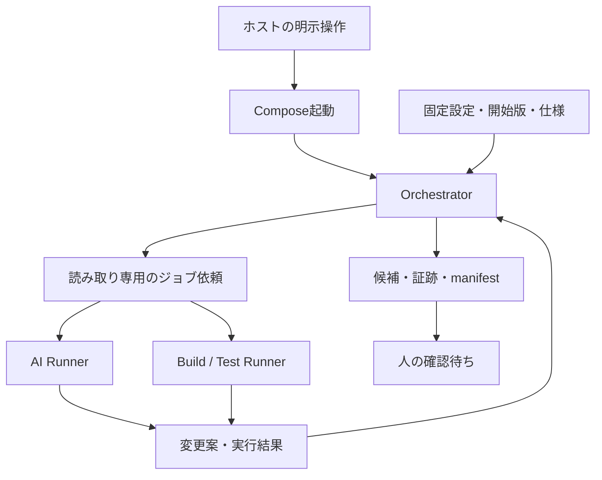

# 選択式モジュール実行基盤

## 目的と範囲

Issue [#56](https://github.com/nakashima-yoshua/feature-map-workflow/issues/56)。
ユーザーが提示した10工程49候補とUbuntu/Docker構成の統合案を、任意の実行基盤として追加する。
既存Skill、Hooks、Feature Map 1.3、Task Runnerは単独利用できる状態を保つ。
第一段階は1案件・1機能・直列実行。全49候補の案件別業務ロジック、分散実行、
Repository API、実DB変更、Windows実行、本番構築、merge、deploy、顧客への送付は含めない。

## 意図と受入条件

- **BEH-001 選択と契約**：49候補を10工程のカタログとして管理し、案件の一枚のJSON設定から必要なものだけ選ぶ。
  入出力、先行ステップ、期待結果の参照、実行先、許可パス、時間上限を事前に固定する。
  未知の定義、未対応実行先、循環・未充足依存を実行前に拒否する。
- **BEH-002 正本**：合意した仕様とテストの期待結果をAI生成結果から分離する。
  Feature Mapは知識の索引であり、ジョブ状態やログを保存しない。既存工程IDを改番しない。
  品質確認は最終工程だけに限定せず、必要な工程内の判定に組み込む。
- **BEH-003 実行分離**：Orchestrator、AI、Build/TestをComposeの別サービスで実行する。
  ホストの明示操作がComposeを起動し、Orchestratorはファイルによる固定ジョブ依頼を送る。
  Dockerソケット、privileged、ホストの認証ディレクトリを共有しない。
  Buildはrun内の候補ソースを読み取り専用で使用し、期待結果やOrchestrator状態を変更できない。
  Build子プロセスにはLandlock ABI 3以降で実行環境・候補の読み取りと私有一時領域だけを許可し、
  Workerの依頼・結果保存先も隠す。未対応カーネルでは実行しない。
  Compose追加設定は同梱の承認対象だけを選べ、起動前に展開後のmount・通信・権限を検査する。
  起動にはrun専用の固定runtime/build contextと検査済みCompose JSONを使い、検査後の元ファイル変更を混入させない。
  起動処理も単一所有者に限定し、実際の展開設定をrunのidentityへ結び付ける。
- **BEH-004 変更制御**：AIは構造化された変更案だけを返す。Orchestratorだけが候補へ適用する。
  変更可能パスを明記し、仕様・テスト・Feature Map・制御設定は保護する。
  全変更案を検査してから書き込む。候補の生成と元リポジトリの変更は分ける。
- **BEH-005 判定と再開**：成功した依存だけを次へ渡す。失敗、停止、時間切れ、証跡不整合はHALT。
  既存依頼を再開時に再送しない。実行済みか不明な作業を自動再試行しない。
  再試行は新しいrunにし、以前のrunを保持する。未実施を成功へ変換しない。
  必須検証には個別の期待値・観測値・判定を含む結果ファイルを必須とし、終了コード0だけで通過させない。
- **BEH-006 識別と証跡**：開始コミット、固定設定、入力ソース、各ステップの入力・出力ハッシュを結び付ける。
  ログ・成果物の保存を確認してから完了を記録する。最終候補・実行証跡を独立したmanifestへ固定する。
  ハッシュは整合性確認であり、署名・WORM・業務合格の証明ではない。
- **BEH-007 人の権限**：正常終了はHUMAN_REVIEW_REQUIRED。人の承認、PR merge、納品、受入、公開は自動実行しない。
  設定へ承認済みを装うフィールドを入れても権限を付与しない。
- **BEH-008 導入と拡張**：オフラインの合成変更案で全経路を再現できる。
  実Codexは既存の限定brokerを再利用し、外部入力許可・対応CLI版・個別の秘密ファイルを必要とする。
  DBとWindowsは未対応能力として明示し、要求時にBLOCKEDとする。後続拡張まで成功を仮定しない。

## 構成と責任

モジュールは論理的な仕事、Runnerは実行環境であり、一対一にはしない。
モジュールの採否と期待結果は人の設定、順序・判定・停止は通常のプログラム、
分析・生成はAI、ビルド・試験は既存ツールが担う。
常駐API・DB・キュー製品を導入せず、単一runのファイル受け渡しに限定する。
同じrunの制御領域はOrchestratorだけが書き、各Runnerの出力領域を分ける。

## 保持・復旧・運用

runは一意な名前でリポジトリ外の私有保存先に作成し、候補と失敗証跡を保持する。
一時ビルド領域はRunnerの終了時に破棄する。runの削除・保存期間・外部バックアップは運用者が管理し、
自動期限削除しない。runごとの上限、コマンド時間、ログ・成果物サイズを制限し、保存失敗はHALTする。
再開は固定設定・元ソース・採用済み証跡との一致を確認し、進行中の不明な結果は人へ戻す。
停止後に作業が残る可能性があるときはComposeの停止と結果の確認を先に行う。

## 検証の選定

| 優先度・層 | 保護する挙動 | 理由 |
| --- | --- | --- |
| P1 / Small | パス逸脱・保護対象・偽承認・変更案全体の拒否 | 仕様と制御の改変を防ぐ |
| P1 / Small | ハッシュ不一致・壊れた結果・重複依頼・不明な再開 | 旧結果の誤採用と二重実行を防ぐ |
| P2 / Small | 49候補・設定・依存・未対応能力 | 選択した工程だけを確実に実行する |
| P2 / Medium | 実プロセスの失敗・時間切れ・出力上限 | 実行境界と終了条件を確認する |
| P1/P2 / Medium | Composeでの変更案→ビルド→試験→証跡→確認待ち | mount・権限・サービス間の実境界を確認する |

実API課金、実DB、Windows実機、全49候補の意味的正しさは今回の試験対象外。
合成例の成功から顧客受入・実環境対応・費用削減を推定しない。

## 根拠と更新先

- 提示案：このチャットの10工程49候補・Ubuntu/Docker構成と、その後の実装依頼。
- 工程・正本：[development-lifecycle.md](skills/feature-map-workflow/references/development-lifecycle.md)。
- 既存の限定実行：[autonomous-task-runner.md](skills/feature-map-workflow/references/autonomous-task-runner.md)。
- 別の未実装構想：[repository-coordination.md](skills/feature-map-workflow/references/repository-coordination.md)。
- 候補一覧：`skills/feature-map-workflow/assets/task-modules.json`。
- 実装・実行コマンド・検証結果はコード、テスト、CI、Issue/PRを正本とする。
