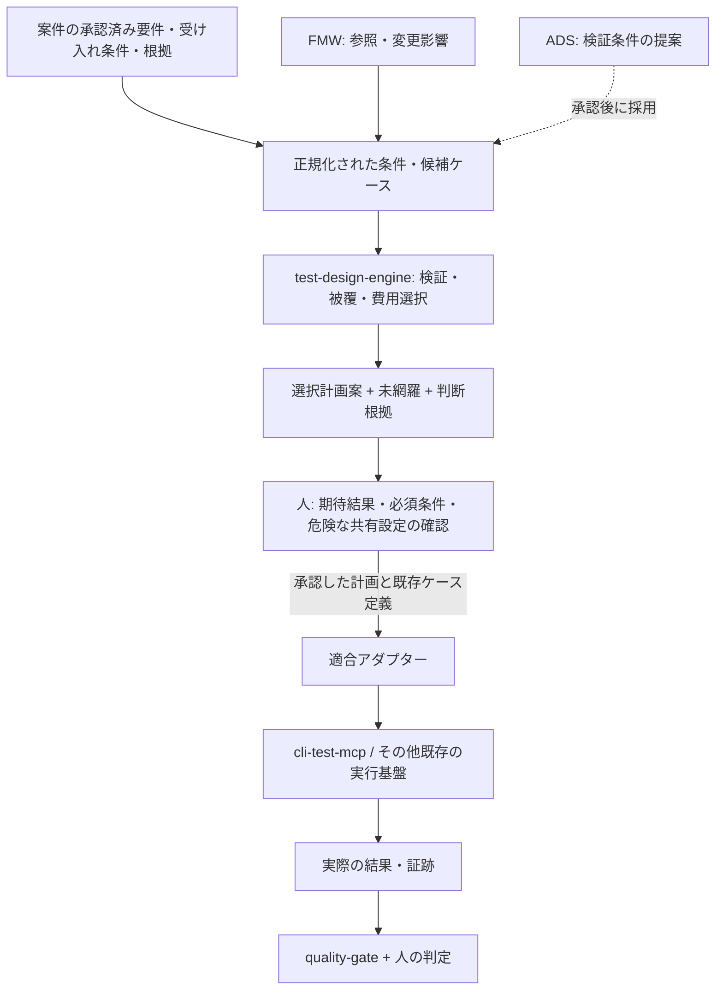

# Test Design Engine — 責務・入出力契約・配置判断（v0.1提案）

> **状態:** 設計提案（未実装、未承認）。2026-11-09 時点の既存リポジトリを前提とする。
> **この変更の範囲:** 設計文書のみ。リポジトリの新設、既存コード・XML/XSD・MCP API・CI・実行環境の変更、テスト実行、品質承認は行わない。

## 1. 結論と達成したいこと

**テスト観点の網羅性を維持し、案件全体のテスト総工数を下げる「選択・計画エンジン」を独立した境界として設計する。**

- 「テストケースが少ない」と「工数が少ない」は別。準備、実行、証跡、復元、原因調査・再試行、保守の費用を区別する。
- 合意済み要求・必須検証条件を実行コストを理由に黙って削除・緩和しない。
- 条件の網羅は**選択されたケースが主張する被覆**であり、実際の PASS・製品品質・要求の完全性を証明しない。
- ケース選択の判断と、実行・証跡収集・品質ゲート・業務承認を分離する。
- 既存の正本（要求、テスト定義、証跡）を複製した新台帳を作らない。

### 今回の配置判断

| 領域 | 正本・責務 | 今回のエンジンとの関係 |
| --- | --- | --- |
| 対象案件 / 利用者 | 合意済み要件、受け入れ条件、オラクル、ケース実体、変更許可 | ID・版と必要な入力だけを受け取る |
| [feature-map-workflow](https://github.com/nakashima-yoshua/feature-map-workflow) | 機能知識・制約・根拠・参照、テスト戦略 | 参照を提供する**任意アダプター**。全件テスト台帳・ソルバーを格納しない |
| **test-design-engine（将来の独立候補）** | ケース候補の整合確認、被覆分析、選択・実行計画案、未網羅/費用/選択理由 | JSON in / JSON out の副作用のない選択処理。業務の期待値は決定しない |
| [cli-test-mcp](https://github.com/nakashima-yoshua/cli-test-mcp) | 合意されたテスト定義の準備・実行・結果・証跡 | エンジンの出力を**別アダプター**が既存 Suite / Case に変換。エンジンは実行しない |
| [quality-gate](https://github.com/nakashima-yoshua/quality-gate) | 必須チェック・改変保護された実証結果の検証・レビュー準備判定 | 選択計画だけで PASS やゲート合格を推定しない |
| [architecture-decision-system](https://github.com/nakashima-yoshua/architecture-decision-system) | 設計規則・必要チェックの提案 | 必要チェックを入力候補にできるが、案件の必須条件化には権限者の採用が必要 |
| [system-understanding-architecture](https://github.com/nakashima-yoshua/system-understanding-architecture) | 変更影響と理解の参照アーキテクチャ | 影響範囲の説明に利用。エンジンへ実装依存を持ち込まない |

既存の [テスト戦略](../skills/feature-map-workflow/references/test-strategy.md#condition-selection-and-verification-cost) と [カバレッジモデル](../skills/feature-map-workflow/references/coverage-model.md) が方針の基準。二重のルール集を作らず、本書は**独立エンジンの境界・契約**に限定する。

## 2. 入力から出力への流れ



**重要な境界:**

1. 要求・オラクル・テスト定義の正本は案件側。FMW XML に全ケースや実行履歴を埋め込まない。
2. エンジンはソースコードを修正せず、実行コマンドを起動せず、DB / ファイルへ副作用を起こさない。
3. 「テストケース候補の被覆」は確認対象の主張。コードカバレッジや実行時の到達性とは別物。
4. 実行側の Suite / Case Schema は独立したバージョン付き契約。専用の変換器で検証し、暗黙に互換とみなさない。
5. 承認前の候補、到達不能な条件、未検証のオラクル、実行不能なケースは別々に示す。

## 3. 最小データ契約（JSON v0.1 案）

### 3.1 入力

入力は、**変更ベースライン、網羅対象の不変スナップショット、候補ケース、選択制約、費用見積り**で構成する。サンプルは概念例であり、JSON Schema や API としては未実装。

```json
{
  "schema_version": "0.1-proposal",
  "plan_id": "PLAN-001",
  "baseline": {
    "change_id": "CHG-001",
    "requirements_revision": "REQSET-001",
    "candidate_revision": "0123456789abcdef0123456789abcdef01234567"
  },
  "policy": {
    "policy_ref": "approved-test-policy-v1",
    "required_condition_ids": ["COND-01", "COND-02", "COND-03"]
  },
  "conditions": [
    {
      "id": "COND-01",
      "requirement_refs": ["REQ-01"],
      "type": "business-rule",
      "priority": "P1",
      "oracle_ref": "spec/REQ-01#normal"
    },
    {
      "id": "COND-02",
      "requirement_refs": ["REQ-01"],
      "type": "boundary",
      "priority": "P1",
      "oracle_ref": "spec/REQ-01#over-limit"
    },
    {
      "id": "COND-03",
      "requirement_refs": ["REQ-02"],
      "type": "regression",
      "priority": "P2",
      "oracle_ref": "spec/REQ-02#unchanged"
    }
  ],
  "candidates": [
    {
      "case_id": "TC-A",
      "covers_claimed": ["COND-01", "COND-02"],
      "case_definition_ref": "tests/cases/TC-A.json",
      "layer": "db-integration",
      "setup_group": "schema-A",
      "estimated_minutes": {
        "setup": 8,
        "run": 3,
        "evidence": 2,
        "reset": 1,
        "diagnosis_retest": 1,
        "maintenance": 1
      }
    },
    {
      "case_id": "TC-B",
      "covers_claimed": ["COND-03"],
      "case_definition_ref": "tests/cases/TC-B.json",
      "layer": "db-integration",
      "setup_group": "schema-A",
      "estimated_minutes": {
        "setup": 8,
        "run": 2,
        "evidence": 1,
        "reset": 1,
        "diagnosis_retest": 1,
        "maintenance": 1
      }
    },
    {
      "case_id": "TC-C",
      "covers_claimed": ["COND-01"],
      "case_definition_ref": "tests/cases/TC-C.json",
      "layer": "ui",
      "estimated_minutes": {
        "setup": 10,
        "run": 5,
        "evidence": 2,
        "reset": 2,
        "diagnosis_retest": 2,
        "maintenance": 3
      }
    }
  ],
  "selection_constraints": {
    "must_include_case_ids": [],
    "forbid_case_ids": [],
    "setup_reuse_approved_groups": []
  }
}
```

#### 入力の意味と検証

- `required_condition_ids` は権限者が確定したスナップショット。エンジンはその分母を編集しない。除外と必須条件の改訂は案件の変更記録で別途承認する。
- `conditions` は要求、シナリオ、ルール、状態、境界、効果などの**識別対象**。必要ならカバレッジ種別ごとの分母を別集計し、一つの総合パーセントへ潰さない。
- `oracle_ref` は実装結果から推測した期待値ではなく、合意済み仕様などへの参照。存在・承認・意味の確認は上流の責務。
- `covers_claimed` は候補の被覆主張。単に同じIDを書けば十分な検証が成立すると扱わない。根拠が無い、到達可能性が不明、誤ったテスト層なら `NEEDS_REVIEW`。
- `estimated_minutes` は計画用の推計。未知コストを0扱いしない。計測値と推定値を将来分けられるよう、実測後に更新できる。
- `setup_group` が一致しても自動で環境を共有しない。再利用できると別途確認されたグループだけを共有コストとして評価する。ケースの初期状態・データ独立性は維持する。
- すべてのIDは一意、参照先は解決可能、費用は有限の非負数、衝突する選択制約は拒否。条件未定義、危険な状態共有、必須ケース欠落、版不一致を成功扱いしない。
- ケース定義の参照先は**案件側で許可されたもの**。エンジンはパスを実行・取得しない。実行アダプターが実在性・権限・スキーマを再検証する。

### 3.2 出力

```json
{
  "schema_version": "0.1-proposal",
  "plan_id": "PLAN-001",
  "state": "NEEDS_REVIEW",
  "selected_case_ids": ["TC-A", "TC-B"],
  "claimed_coverage": {
    "required": 3,
    "claimed_covered": 3,
    "uncovered_condition_ids": []
  },
  "case_reasons": [
    {"case_id": "TC-A", "covers": ["COND-01", "COND-02"]},
    {"case_id": "TC-B", "covers": ["COND-03"]}
  ],
  "excluded_candidates": [
    {"case_id": "TC-C", "reason": "redundant_claimed_coverage_and_higher_estimated_cost"}
  ],
  "cost_estimate_minutes": 32,
  "warnings": [
    "coverage claims, oracles and setup reuse require independent review"
  ],
  "execution_status": "NOT_RUN",
  "approval": "NOT_GRANTED"
}
```

上記の32分は**環境共有を認めないサンプル費用**（TC-A: 16分 + TC-B: 14分 = 30分）とは一致しないため、実装時には必ず費用項目の合計と出力の整合を検証する。**サンプル出力の計画費用は設計レビュー対象の値であり、このまま計算済み値として使用しない。**

状態の区別:

- `PLAN_CANDIDATE`: 入力整合と宣言された被覆・制約を満たした選択案。実行済み・承認済み・欠陥なしを意味しない。
- `NEEDS_REVIEW`: 期待値・被覆根拠・費用・再利用安全性など、未確認の重要事項がある。
- `BLOCKED`: 必須条件を満たす実行可能な候補が無い、必須制約が矛盾する、重要な入力が欠落する等。分母を減らして成功にしない。

本来の出力には入力・ポリシーの版、選択理由、未網羅条件、対象外理由、非採用ケース、未知費用/未確認事項、算定モデルの版を含める。出力だけでケースの PASS や人の承認を作らない。

## 4. 選択・費用最適化アルゴリズム

**初期版は決定的な貪欲法でよい。** 正確な最小集合被覆ソルバー、ペアワイズ生成器、LLM制御やテストエンジンは v0.1 の必須要件にしない。

1. **凍結:** 合意済みスコープ、必須条件ID・優先度・改訂版を保持。入力不備は FAIL-CLOSED。
2. **必要条件の分類:** 条件ごとにP1/P2/P3と必要なオラクル、観測点、最安の十分なテスト層を参照。高影響条件をコスト優先で捨てない。
3. **候補の確認:** ケースの被覆主張を登録。要求の未確定・到達不能・外部権限・オラクル不明はレビュー/ブロック理由として残す。
4. **強制ケース:** `must_include_case_ids` を先に採用。禁止との衝突は `BLOCKED`。
5. **繰返し選択:** 未網羅の必須条件を新たに覆う便益を、当該候補の**限界増分コスト**で割って選ぶ。同値なら安定したケースID順。共通セットアップ費は安全な再利用が確認された場合に限り一度だけ計上する。
6. **実行可能性確認:** 選択後も未網羅の必須条件が残れば `BLOCKED`。既知の失敗、不可能な操作、権限不足を成功扱いしない。
7. **計画生成:** 実行順序は独立性、前提条件、復元制約を優先。安全な同一環境内でのみセットアップ切替を減らす。実行ツールが受け取れる形式への変換は別工程。
8. **報告:** 残余条件、選択/除外理由、仮定、見積工数と基準案との差、未知コストを出す。過去の失敗履歴は元の結果のまま保全する。

コストの基本形（計画用）:

```text
total_cost(plan) =
  sum(safe_distinct_setup_group_costs)
  + sum(per_case_run + evidence + reset + expected_diagnosis_retest + maintenance)
  + cost_of_required_transitions
```

費用は単純加算とは限らない。初期段階では共有可否を明示し、未知の切替費は比較不能としてレビューを要請する。誤差を含む推定値を厳密な費用削減実績として示さない。

**ペアワイズ・高次組合せの生成は次段階:** 要求の制約で到達可能な組合せを確認してから候補生成に使用する。業務上必須の3条件以上の組合せ、拒否動作、状態遷移、トランザクションは別途保持する。

## 5. 実行・品質ゲートとの互換性

- `test-design-engine` の `selected_case_ids` と、案件内の**バージョン固定された**実行可能ケース定義を外部アダプターが結び付ける。ケースIDだけで実行ファイル・DB書込みを決定しない。
- `cli-test-mcp` の Suite / Case / Attempt / Batch、ログ保存・リセットの仕様は同リポジトリが所有する。エンジンはこれらの内部クラスに依存しない。
- 2026-11-09時点では `cli-test-mcp` に分割PR #2（定義検証）、#3（Runner）、#4（MCP）があり、実装移行中。各PRの採用後に**実際の確定Schema**へ変換アダプターを合わせる。現在の設計例を確定APIとして扱わない。
- `quality-gate` が必要とするのは実行したリビジョンの真正な結果と証跡。計画の `claimed_coverage` だけを PASS・`READY_FOR_HUMAN_REVIEW` 判定に渡さない。
- FMWは結果の出典、ケースID、run ID、Git SHA等を参照するだけ。プロジェクト固有のテスト全件・費用台帳・証跡ファイルをコピーしない。
- CI/人の承認/実行環境の権限をこの選択ツールに付与しない。機密データや本番DBをAIに転送せず、利用時の読取り範囲を限定する。

## 6. 最小パイロットと受け入れ条件

まず既存案件の**小さな一機能変更**で、現在のテスト計画と選択案を比較する（実施には案件側の権限が必要）。

| 検証ID | 入力 | 必須の結果 |
| --- | --- | --- |
| AC-01 | 必須条件3件、複数候補、一部被覆重複 | 全必須条件を被覆主張する選択案、選択/除外理由 |
| AC-02 | P1必須条件を覆う候補なし | `BLOCKED`、未網羅IDを列挙。勝手に分母を減らさない |
| AC-03 | 必須ケースと禁止ケースが衝突 | `BLOCKED`、矛盾を指摘 |
| AC-04 | セットアップ名が同じで共有承認なし | コストを誤って一回にまとめない |
| AC-05 | 同じ入力・版・設定 | 同じケース選択と理由を返す（決定性） |
| AC-06 | 候補に高リスクな未検証オラクル | `NEEDS_REVIEW`、実行済み/合格を主張しない |
| AC-07 | 既存失敗・未実施・対象外の条件がある | 元の履歴を維持し、現在の計画上の分母と区別 |
| AC-08 | 実行アダプターなし | 選択案のみ返し、MCPやDB/ファイルを変更しない |

パイロットで実測するのは**人の準備時間、実行時間、証跡収集、再実行/原因調査、保守作業**。必要条件の取りこぼし、重要な不具合検出力、手動確認の増減も比較する。実測前に削減率や品質向上を断言しない。

## 7. リポジトリ新設の判断条件と次段階

### 現在（このPR）

- 本書をFMW側に**境界設計・連携提案**として保存。FMWコアやXMLを拡張しない。
- ケース選択の実装を `cli-test-mcp` や `quality-gate` に追加しない。
- 現行FMWのテスト戦略・案件内の既存テストケースを引き続き使用する。

### 新設を検討する条件

1. 少なくとも一つの実案件で、独立した条件/候補JSONにより選択価値を検証できる。
2. 入出力契約、単体テスト、障害時の出力、版管理を外部利用可能な形で定義できる。
3. FMW固有の意味やテスト実行エンジンを抱えずに単独テスト・単独リリースする合理性がある。

満たした段階で `nakashima-yoshua/test-design-engine` の作成を**別判断**とする。初期実装はオフラインPython CLI + JSON + 標準ライブラリ、セット被覆と未網羅検出に限定。ペアワイズ生成・高精度費用ソルバー・MCP・専用DBは計測結果に応じて後続判断。

**本提案の完了条件:** 責務境界、入力/出力、最小アルゴリズム、テスト条件、リポジトリ分離基準がレビュー可能な文書として揃うこと。コードの動作検証や実案件での効果実証は含まない。
