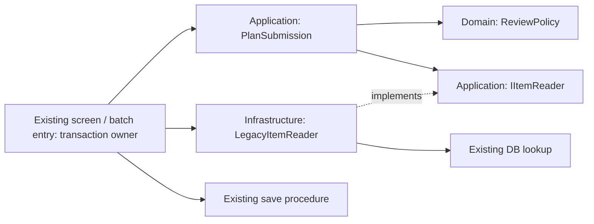

# Fictional legacy feature: request review

Use this worked example with [Incremental Modernization, Step 2](../../skills/feature-map-workflow/references/incremental-modernization.md#optional-abc-decision-for-a-legacy-feature-addition). All names, rules and routes below are invented. They are assumptions for a design exercise, not observations of a customer system.

**Status:** design proposal with C# sketches. The application/adapter sketch can be compiled and exercised with an in-memory reader; that is synthetic evidence only. No runnable DB adapter, deployed feature, actual permission/transaction/performance result or measured cost saving is supplied. Real-system checks below remain **not-run**.

## One feature and its evidence boundary

Assume a C#/.NET legacy screen submits an item/quantity through `Submit_Click` -> `SubmitRequest` -> `SUBMIT_REQUEST` in an existing DB transaction. A batch uses its own submission handler to call the same procedure; there is no shared C# rule boundary today. The procedure owns persistence and existing business rules. The proposed feature adds one independently confirmed rule: a request needs review when the item is restricted **or quantity is at least 100**. Positive-quantity validation, authorization, error mapping and the final save remain at their current entry/procedure boundaries.

For this exercise, assume the procedure already accepts a review flag and reads/writes under the caller's transaction, with no internal commit or autonomous transaction. **Verify those assumptions before applying B.** If the flag, schema or transaction contract needs a change, stop dependent implementation until the affected owner authorizes it. If PL/SQL already owns the review decision, keep it there instead of adding a second authority in C#.

Reuse the existing [legacy analysis](../../skills/feature-map-workflow/references/legacy-analysis.md) and [test strategy](../../skills/feature-map-workflow/references/test-strategy.md):

| Trace/evidence needed | Assumed boundary; still to verify in a real system |
| --- | --- |
| Entry to rule | Screen event -> `SubmitRequest` and batch -> its handler -> the shared procedure; inspect dispatch and identify where both can call the new rule |
| Data/dependencies | Item restriction lookup, request rows, `SUBMIT_REQUEST`, permissions/configuration and any trigger/job/external I/F; unknown effects stay `open` |
| Transaction and side effects | Same connection/transaction for lookup and save; inspect locking/isolation, commit owner, trigger effects, failures, retries and operator recovery |
| Existing oracle/evidence | Characterize current status/error/DB effects first; obtain business approval for the intentional review-rule delta |

## Compare A/B/C for this request

These are qualitative design estimates under the assumptions above, not measured delivery results.

| Criterion | A: local change | B: new rule behind a small boundary | C: gradual replacement |
| --- | --- | --- | --- |
| Change spread / shared rules | Lowest cost if one common method already owns the decision | Useful if UI/batch otherwise duplicate the independent new rule; keep existing shared DB rules in the procedure | More routing/coexistence work for a feature that needs no replacement |
| Dependency direction / tests | Existing dependencies remain; cheapest when current functional/DB tests suffice | Application owns a reader port; Infrastructure implements it; pure rule combinations can be tested without UI/DB | Shared contract and route tests plus old/new equivalence required |
| Runtime / transaction | Existing query/save pattern and transaction | Reuse the same lookup and transaction, no extra DB round trip or new commit; measure rather than assume equality | Switchback must preserve in-flight requests and committed state; dual writes are not justified |
| Team / migration / total cost | Choose when current structure is cohesive and supportable | Choose only if avoided duplication and simpler verification outweigh adapter and support costs; team must own the extra boundary | Reject here: no controlled replacement need or benefit to offset operating two implementations |

**Adopt B only for the assumed duplicated-rule problem:** one application use case and a pure rule serve the existing screen and batch handlers; a thin adapter reads through the existing DB session. Shared legacy persistence rules stay in PL/SQL. This is a compile-time responsibility boundary, not a new service, DB owner, framework or mandatory four-project layout.

**Reject B/C and choose A** if inspection instead finds one cohesive shared method/procedure, existing inexpensive tests and no harmful dependency for the change. Add the condition there and retain its architecture: extracting an interface and adapter would buy no current benefit. **Keep as-is** if investigation shows the approved review rule already exists and the request is resolved by an authorized configuration correction; do not fabricate a refactoring task.

C becomes relevant only for a separately justified replacement: use Strangler Fig when an existing entry can route a controlled subset of requests; consider Branch by Abstraction for swapping an implementation behind the same entry/contract. Neither is needed just to add this condition.

## B: minimal dependency direction



Arrows show source dependencies; the runtime port call is fulfilled by the adapter. Application/Domain do not import the legacy DB, SQL/ORM types or UI. The existing entry composes the adapter and application directly; no DI container or new library is necessary.

The following is a self-contained **type sketch** (C# 12 or later). A reader stub can exercise it; the adapter delegates to an existing lookup rather than owning a connection or transaction. Place the types in existing modules as appropriate, without mechanically creating new projects.

```csharp
// Domain: the new rule only; valid positive quantity is an entry precondition.
public static class ReviewPolicy
{
    public static bool NeedsReview(bool restricted, int quantity) =>
        restricted || quantity >= 100;
}

// Application: owns its required read contract and use case.
public interface IItemReader
{
    bool IsRestricted(string itemId);
}

public sealed class PlanSubmission(IItemReader items)
{
    public bool NeedsReview(string itemId, int quantity) =>
        ReviewPolicy.NeedsReview(items.IsRestricted(itemId), quantity);
}

// Infrastructure: thin bridge to the existing lookup in its current session.
public sealed class LegacyItemReader(Func<string, bool> readRestricted) : IItemReader
{
    public bool IsRestricted(string itemId) => readRestricted(itemId);
}
```

Inside **each existing** submission entry (screen and batch), the intended integration is the following adaptation sketch. The `legacy` methods stand for existing, verified application methods; this block is **not standalone executable code**:

```csharp
legacy.RequireSubmitPermission();          // Existing role check, for screen AND batch.
legacy.ValidateItemAndQuantity(itemId, quantity);
using var tx = legacy.BeginExistingTransaction();
var app = new PlanSubmission(new LegacyItemReader(
    id => legacy.ReadRestricted(id, tx)));  // Same lookup/connection/isolation.
bool needsReview = app.NeedsReview(itemId, quantity);
legacy.SubmitRequest(itemId, quantity, needsReview, tx); // Existing procedure, once.
tx.Commit();
// On failure, preserve existing rollback/disposal, error mapping and logs.
```

Do not assume that `Dispose` rolls back, that a procedure never commits, or that an item cannot change between read and save: establish the real transaction/locking contract. A throwing lookup must not reach save; a failed save must not commit. Preserve existing retry/idempotency and downstream side-effect semantics. If either route cannot retain its session/permission boundary, revisit A/B rather than silently widening the design.

## Verify within the existing test phases

Reuse [observable legacy behavior](../../skills/feature-map-workflow/references/incremental-modernization.md#step-3-establish-observable-legacy-behavior) and the [test boundary contract](../../skills/feature-map-workflow/references/test-strategy.md#test-boundary-contract). Keep a case's fixture, expected result, source revision, DB before/after, reset and evidence link together in the existing evidence store; retain only durable links/decisions in the Feature Map. Do not normalize away unexplained differences.

| Check | Expected observation and evidence | Layer / status in this example |
| --- | --- | --- |
| Rule boundaries | Unrestricted 99 -> false; 100 and 101 -> true; restricted 1 -> true. Reader returns the selected item's restriction and propagates failures. | Pure-rule/application synthetic check; does not prove DB or entry behavior |
| Existing entry contracts | Screen and batch reach the intended rule; previous invalid-input/missing-item/error behavior and denied-role behavior are retained; denied role causes no writes | Characterization + functional/permission checks; **not-run** |
| Approved behavior delta | Equivalent isolated initial state and requests before/after; review flag differs only for the approved new rule; other output/schema/API/PL/SQL contracts and side effects remain compatible | Existing entry + real test DB; **not-run** |
| Failure / retry / concurrency | Lookup failure: no save; save failure: transaction rolled back, no partial rows; retry/duplicates and concurrent item changes obey the established contract | Real test DB with failure injection and reset; **not-run** |
| Performance / operation | Compare representative lookup counts, latency, locks and logs with the baseline against agreed limits; operator can identify failure and recover | Integration/load/operational evidence; **not-run** |
| Cutback / data recovery | Revert the code or authorized route to the previous implementation; separately verify handling of already committed review flags and any downstream effects | Deployment/recovery rehearsal in an authorized environment; **not-run** |

For checks that cannot be automated, assign a human owner and give the fixture, action, expected observation and evidence location; retain **not-run** until that person performs them. Do not claim rollback safety from the diagram or the pure-rule result. A switchback alone cannot reverse committed data.

Record the selected A/B/C and rejected alternatives in the existing `knowledge/decision` with its reason, relevant entry/DB references in `sourceMap`, assumptions under `open` and actual evidence under `verify/case`. Use existing `planned`/`not-run` status until executed. Documentation of a design, compilation of the sample, implementation in an actual system and actual-system verification are four separate claims.
