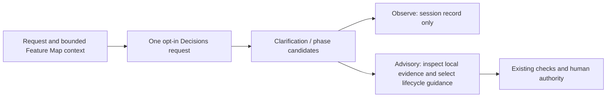

# Decision Providers

## Purpose

Bounded probabilistic judgments are behind a provider boundary so the workflow does not depend on one classifier vendor.

The provider may advise:

- whether clarification is likely required;
- which missing-context category is most material;
- whether a durable Feature Map update is likely;
- which Feature Map section is the best candidate;
- whether human review is likely required;
- which existing lifecycle phase best describes the current requested work (OpenAI, separate opt-in).

It must never establish repository facts or perform writes.

## Providers

### off

Default. No external decision call.

### jev

Legacy-compatible external provider using the TypeSafe Jev API. No new Jev dependency is needed for OpenAI or the runner.

The existing `FEATURE_MAP_JEV_*` variables remain supported for backward compatibility.

### openai

Implemented generally available API adapter for `POST https://api.openai.com/v1/decisions`.
The default model is `gpt-6-luna`; authentication uses `OPENAI_API_KEY`, without
TypeSafe credentials. Request `input` is a JSON text string; `questions[]` has
named `predicate` and `choice` items. Predicate answers normalize `probability`
to the existing hook's numeric fields. Choice questions use
`choices[{value,description}]`; named `answers[]` normalize to the existing
result keys. There is no Jev `state`, `noul`, or `criteria` wire format.

Context questions are `context_sufficient`, `question_required` and
`missing_context_type`. Completion questions are `update_required`,
`update_section` and `human_review_required`. No score or open-ended business
decision is requested. The API boundary is isolated in `OpenAIDecisionsProvider`.
See the [official guide](https://developers.openai.com/api/docs/guides/decisions)
and [API reference](https://developers.openai.com/api/reference/resources/decisions/methods/create).

Missing/duplicate/unnamed answers, refusal, wrong model/type, unknown choices,
nonfinite or out-of-range numbers and malformed response bodies produce
undetermined advice, never a fabricated zero/false answer. 401/403/429/5xx and
timeouts fail open for advice only; deterministic/permission/approval gates keep
their independent fail-closed policy. No retries or raw response logging occurs.
Redirects are refused to avoid forwarding credentials to another host.

Selecting `openai` does not enable either call site automatically. Generic modes
default to `off` and never inherit legacy Jev content modes. Explicit `off`
overrides old modes. Old unset-provider Jev configurations continue to select Jev.
The separate `FEATURE_MAP_DECISION_PHASE_MODE=prompt` opt-in can enable a phase-only
request even when the context mode is off; it never selects a provider itself.

## Work phase and observation policy

Use the existing [12 lifecycle phases](development-lifecycle.md), not a new workflow.
`current_phase` is one closed choice from those phases plus `unknown`. Questions
classify the current requested activity, not the final delivery objective or the
Feature Map state. Mixed-phase work yields a principal activity; it does not
establish that earlier work is complete. The full enum is owned by
`OpenAIDecisionsProvider.PHASE_CHOICES`.



- OpenAI defaults to `FEATURE_MAP_DECISION_POLICY=observe`: normalized context,
  phase and completion results are saved in the existing local session record,
  but do not add advice or block completion. Required local gates still run.
- Explicit `advisory` restores existing clarification/update/review advice and
  completion reminders. Conflicting OpenAI answers with `update_section=none`
  never trigger an update reminder, even if `update_required` is high. Phase candidates are displayed only at confidence >= 0.75
  and when the choice is not `unknown`. No candidate automatically switches a
  Skill, advances a phase, passes a check, approves, publishes or grants permission.
- Jev retains its existing advisory default. An invalid policy becomes `observe`.
- At UserPromptSubmit, phase and eligible context questions share **one request**.
  Phase opt-in runs even without ambiguity signals. Without that opt-in, the
  existing context signal/high-impact-open filter remains. An old context result
  is cleared before saving the current turn; no prior phase is reused as fact.
- Completion questions retain the existing code-changed/map-unchanged filter.
  They do not add another phase call. API failures/refusals stay undetermined;
  deterministic gates are never relaxed.

Start with observe and inspect results on representative synthetic cases before
advisory use. Compare missed/false clarification and update suggestions, phase
confusion/unknown rates, end-to-end wait and human intervention. The current
thresholds are policy defaults, not calibrated accuracy claims. Low-confidence or
unknown phase advice falls back to ordinary local interpretation.

A minimal opt-in evaluation configuration is:

```sh
FEATURE_MAP_DECISION_PROVIDER=openai
FEATURE_MAP_DECISION_POLICY=observe
FEATURE_MAP_DECISION_CONTEXT_MODE=prompt
FEATURE_MAP_DECISION_COMPLETION_MODE=summary
FEATURE_MAP_DECISION_PHASE_MODE=prompt
```

These settings enable content transmission for that configured environment;
obtain authorization first and use them only where contract and data policy permit it. No settings are installed
automatically. To stop all OpenAI transmission, select provider `off`.

### Data handling

OpenAI `metadata` contains only counts, presence flags and fixed categories/statuses;
it does not send feature names, purpose, source paths, prompt, diff or assistant
text when phase mode is off. Context `prompt` or phase `prompt` sends up to 3000
characters of the current request plus `purpose`, `done`, `scope` and `exclude`
(up to 1000 characters each). Phase opt-in therefore explicitly adds content even
when context mode is `metadata` or `off`. Completion `summary` sends the same four
bounded Feature Map fields plus
up to 3000 characters of assistant text; `diff` additionally sends up to 8000 characters
of source diff. Known credential patterns, secret environment values, PEM private
keys and email addresses are redacted before truncation. This is not comprehensive
PII/DLP filtering. If content cannot be sent under contract, use `off`; review
content before opting in. Model selection and input mode changes need evaluation,
not silent promotion of an API availability announcement to measured workflow quality.

Repository tests mock transport, both hook call sites, failure modes and legacy
selection. Production latency, accuracy and total workflow benefit are not established
by mocked tests or a small synthetic live probe; probe outcomes belong in the PR. A separately
authorized optional smoke test can call `context_decide` and `completion_decide`
with synthetic non-sensitive inputs, record only normalized answers and measured
timing, and leave required gates untouched. Successful responses retain only
normalized answers, `elapsed_ms` and nonnegative integer token counts from `usage`;
raw request/response content is not added to the session record. A transport timeout
is 2 seconds by default (`FEATURE_MAP_DECISION_TIMEOUT_SECONDS`, valid 0.1–8 seconds;
invalid values use 2). This is a transport timeout, not an end-to-end latency SLA.
No image, score, conversation-history or explicit prompt-cache integration is
introduced for phase classification; existing JSON text input remains supported
by the GA contract.

## Generic configuration

Select the provider:

```sh
FEATURE_MAP_DECISION_PROVIDER=off
FEATURE_MAP_DECISION_PROVIDER=jev
FEATURE_MAP_DECISION_PROVIDER=openai
```

Generic privacy/input modes:

```sh
FEATURE_MAP_DECISION_CONTEXT_MODE=off|metadata|prompt
FEATURE_MAP_DECISION_COMPLETION_MODE=off|metadata|summary|diff
```

Generic thresholds:

- `FEATURE_MAP_DECISION_CONTEXT_THRESHOLD` (default 0.75)
- `FEATURE_MAP_DECISION_UPDATE_THRESHOLD` (default 0.70)
- `FEATURE_MAP_DECISION_REVIEW_THRESHOLD` (default 0.85)
- `FEATURE_MAP_DECISION_MODEL` (provider-specific model identifier)

When the generic variables are absent and Jev legacy modes are enabled, the provider is inferred as `jev`.

## Boundary

Keep these deterministic:

- file existence and exact source references;
- Git state, hashes, branches, and commits;
- XML parsing and XSD validity;
- numeric policy thresholds;
- permissions and authorization;
- destructive or irreversible actions;
- queue/dependency/conflict transitions.

A provider result is advisory evidence only. The coding model or deterministic policy must reconcile it with current repository evidence before acting.
